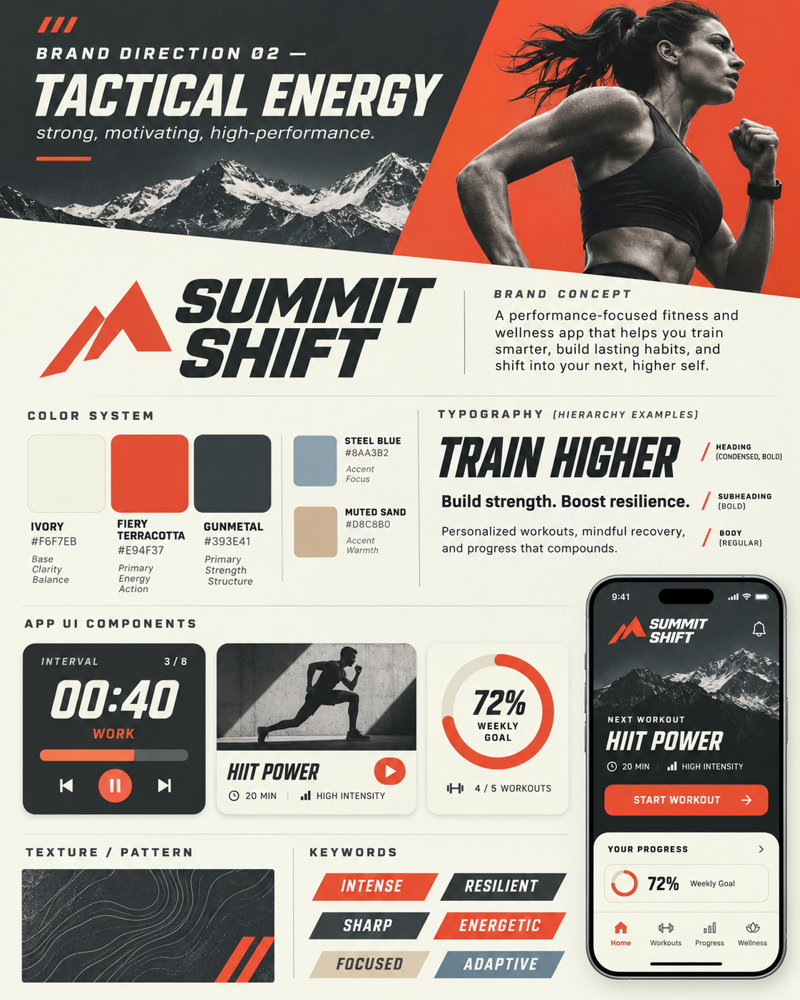

# Design system — Tactical Energy

**Approved direction:** The *middle* of the three generated brand boards, selected 2026-11-10.  
**Status:** Palette and overall style approved. Specific fonts, logo, name, dimensions, and components below are implementation recommendations until reviewed in the app.



> The reference image says **Summit Shift** solely as placeholder branding. It is an inspiration board, not a pixel-exact production spec, and not evidence the name/logo is approved.

## 1. Brand character

**Strong, motivating, high-performance.** Aim for premium tactical-athletic energy balanced with professional accessibility: clear hierarchy, purposeful dark surfaces, confident headings, dynamic restrained diagonals, and high legibility. Avoid gratuitous militarism, clutter, fake urgency, clip art, unnecessary animation, or macho-only photography.

## 2. Approved five-color system

Exactly three original brand colors and two complementary colors. Do not add sage, neon green, purple, or additional standalone brand hues without approval.

| Token | Color | Hex | Primary use |
| --- | --- | --- | --- |
| `ivory` | Ivory | `#F6F7EB` | Light backgrounds, text on dark surfaces, spacious areas |
| `terracotta` | Fiery Terracotta | `#E94F37` | Brand accent, highlights, progress, shapes, selected details |
| `gunmetal` | Gunmetal | `#393E41` | Dark sections, text on ivory, navigation and strong surfaces |
| `steel` | Steel Blue | `#8AA3B2` | Secondary information, selective highlights and focus areas |
| `sand` | Muted Sand | `#D8C8B0` | Secondary panel fills, muted UI elements, warm visual balance |

### Copyable CSS tokens

```css
:root {
  --color-ivory: #F6F7EB;
  --color-terracotta: #E94F37;
  --color-gunmetal: #393E41;
  --color-steel: #8AA3B2;
  --color-sand: #D8C8B0;
}
```

**Recommended usage ratio, not a hard constraint:** ~50% ivory, ~30% gunmetal, ~12% terracotta, ~5% sand, ~3% steel. The app may use dark-mode-like hero cards against ivory surfaces. Use alpha overlays or lighter/darker *derived shades of these five* rather than inventing extra brand colors.

### Accessibility guardrail

The brand board is conceptual. Some pictured text/button combinations may fail accessible contrast requirements. Notably, **ivory text on original terracotta is only about 3.44:1**, below the 4.5:1 WCAG AA target for ordinary text. Gunmetal text on ivory is about 10:1. For normal-size text/buttons, choose a compliant combination (e.g. ivory on gunmetal) or a tested darkened terracotta state. Check all pairings with a contrast tool; don't infer that a beautiful mockup is accessible.

Do not use color as the sole indicator of a workout's completion, selection, or error state. Label it and use an icon/pattern too.

## 3. Typography

- **Display/hero (PROPOSED):** Condensed bold athletic sans, e.g. Barlow Condensed or another licensed/available equivalent. Use sparingly for punchy titles, duration callouts, and training headings.
- **UI headings (PROPOSED):** A legible contemporary sans in semi-bold/bold, such as Inter.
- **Body (PROPOSED):** Inter/system sans with straightforward numerals and highly readable workout instructions.
- **Typography behavior:** sentence case for instructions, uppercase labels for compact metadata, numerals for rounds/time, clear unit spacing. Avoid large all-caps paragraphs.
- Use weight/spacing/scale, not repeated accent colors, to form hierarchy. Ensure responsive text without clipping.

The mockup uses a graphic athletic wordmark, but **the wordmark is not approved**.

## 4. Layout patterns

- **Overall:** modular, high-contrast sections with significant breathing room and consistent alignment.
- **Mobile-first:** sessions must be readable one-handed on phones, but also work on station computers/tablets.
- **Home:** current week, four prescribed sessions, one obvious next action, and private progress.
- **Session view:** title/category/duration → scaling → warm-up → work blocks → cooldown → completion/logging.
- **Cards:** restrained radius, subtle border/background changes, adequate padding. Avoid infinite card nesting or gratuitous drop shadows.
- **Dark surfaces:** use for headers, timers, and select high-emphasis panels, not necessarily every screen.
- **Photography:** functional fitness and real people in credible settings; diverse ages and capabilities. Mountain/topographic references can be used sparingly, without overwhelming content.

## 5. Critical workout numbering rule (approved)

Strength prescriptions may display **small individual numbers**:

```text
01  Goblet squat            3 × 8
02  Dumbbell bench press    3 × 10
03  Supported row           3 × 10
```

AMRAP / MetCon / circuit content should display **one small number for the group**, then plain subordinate lines:

```text
02  12-MIN AMRAP
    8 step-ups
    10 push-ups
    150 m row
```

For intervals, use a block header and work:rest cycle details, **not** a prominent number on every instruction. Keep block numbers smaller than the workout titles; never show giant repetitive numerals on every exercise.

## 6. Interaction rules

- Clear selected, active, disabled, completed, and unsaved states.
- Completion feedback may be tactile/visually satisfying, but restrained and never a noisy game mechanic.
- Avoid default-on sound; respect reduced-motion preferences.
- Allow scaling selection without implying a lower fitness level is a failure.
- Progress should feel encouraging without pressuring training through illness or injury.
- Tap targets and focus indicators must be usable for people on phones, potentially tired or wearing work clothes.
- Make completion reversible during testing, and carefully confirm destructive/reset actions.

## 7. Component inventory to standardize

| Component | Content/behavior |
| --- | --- |
| App header | Neutral project title until brand name approved; logo placeholder only |
| Weekly session card | Session type, title, time, progression/completion state |
| Scaling control | Beginner / Standard / Advanced with clear selected indicator |
| Strength row | Small item number, movement, prescription, optional note |
| Workout block | One number + type/duration + nested movements |
| Interval display | Time, work/rest designation, round progress, controls |
| Primary action | Accessible high-contrast start/complete action |
| Personal progress | Count, simple bar/summary, recent sessions |
| Private log | Optional, visibly labeled as personal, with save feedback |

## 8. Brand artifacts and approval checklist

- **Approved:** Visual approach Tactical Energy; color names and hex values above.
- **Proposed:** Condensed heading typeface, exact iconography, card radius, component dimensions, imagery direction.
- **Open:** Final name, logo, tagline, domain, brand use beyond JHFEMS.
- **Avoid:** `FireFit OS` as the default brand; emoji flames; treating the generated mountain mark as production-ready artwork.

When a visual choice is approved in a coding session, record the exact font, CSS variables, screen, and component path here. The live app may still have older colors until intentionally migrated.
